  

  
  
  
  
  
  

---

<h2 align="left">🎯 About Me</h2>

- 🎓 B.Tech in Computer Science and Engineering at **Sri Vasavi Engineering College (2023–2027)** — **CGPA: 8.37/10**.
- 💻 Focused on **Java, SQL, JDBC, Object-Oriented Programming, and Data Structures & Algorithms**.
- 🌐 Building full-stack applications with **React, Node.js, Express.js, and databases**.
- 🧩 Practiced **490+ coding problems** on LeetCode and GeeksforGeeks, as listed in my resume.
- 🚀 Interested in building useful applications and continuing to grow as a software developer.
- 💬 Ask me about Java fundamentals, Java Collections, SQL, and DSA problem-solving.

---

<h2>🛠️ Tech Stack</h2>

**Programming Languages**  
  

**Java & Core Concepts**  
  

**Frontend**  
   

**Backend**  
 

**Databases**  
  

**Tools**  
    

---

<h2>🚀 Featured Projects</h2>

### 🐄 <a href="https://yshdairyfarm.vercel.app/">Dairy Farm Management System</a>
A web application in development to support cattle record management, milk production tracking, and day-to-day dairy farm operations.

   

### 🌐 <a href="https://ysh-portfolio-ten.vercel.app/">Personal Portfolio Website</a>
A personal website showcasing my technical skills, projects, certifications, and achievements.

   

### 🍽️ <a href="https://yeswanthsrip.ccbp.tech/">Food Munch</a>
A responsive food-themed website presenting food items and offers with a clean layout.

  

---

<h2>🏆 Achievements</h2>

<table>
  <tr>
    <td><strong>🥇 First Place</strong> Microsoft Hackoverflow Maizthon</td>
    <td>Won first prize after a three-day technical workshop and a two-day hackathon.</td>
  </tr>
  <tr>
    <td><strong>🥇 First Prize</strong> Mathematics Day</td>
    <td>Built an HTML/CSS website demonstrating the importance of mathematics in computing.</td>
  </tr>
  <tr>
    <td><strong>💡 490+ Problems</strong> Problem Solving</td>
    <td>Practiced coding problems on LeetCode and GeeksforGeeks, as listed in my resume.</td>
  </tr>
</table>

---

<h2>📜 Certifications</h2>

- 🟥 **MySQL 8.0 Database Developer** —   
  Oracle Certified Professional · MySQL and database development

- 🟦 **Introduction to Databases — SQL** —   
  SQL fundamentals and database concepts

- 🟩 **Developer Foundations** —   
  Git, GitHub, command line, and version control

- 🟧 **Industry Ready Certification in Full-stack Development** —   
  <em>Listed as ongoing in my resume</em>

---

<h2>📊 GitHub Stats</h2>

  
  

  <a href="https://github.com/Yeswanthsrip">View my live GitHub contribution graph and activity</a>

> Stats cards are loaded from a third-party service and may occasionally be unavailable or delayed. Values are not manually entered.

---

<h2>🤝 Connect With Me</h2>

  <a href="https://ysh-portfolio-ten.vercel.app/">Portfolio</a> ·
  <a href="https://linkedin.com/in/Yeswanthsrip">LinkedIn</a> ·
  <a href="mailto:sriyeswanth9@gmail.com">Email</a> ·
  <a href="https://github.com/Yeswanthsrip">GitHub</a> ·
  <a href="https://leetcode.com/u/yeswanthsriP/">LeetCode</a> ·
  <a href="https://www.geeksforgeeks.org/profile/sriyeswrmhk">GeeksforGeeks</a>

  

